<div align="center">

  <!-- HERO BANNER -->
  <a href="https://github.com/Alansi2025">
    
  </a>

  <br/><br/>

  <!-- TYPING SVG -->
  <a href="https://github.com/Alansi2025">
    
  </a>

  <p align="center">
    <strong>Crafting intelligent, scalable web applications and multimodal AI architectures.</strong>
  </p>

  <!-- SOCIAL / BADGES -->
  <p align="center">
    <a href="https://www.linkedin.com/in/aditya-singh-70b295359/" target="_blank">
      
    </a>
    <a href="https://leetcode.com/u/wV2flvSWS2/" target="_blank">
      
    </a>
    <a href="mailto:aditya25mca024@ncuindia.edu">
      
    </a>
    
  </p>

</div>

---

### 👨‍💻 About Me

```yaml
name: Aditya Singh
degree: Master of Computer Applications (MCA), 2025 - 2027
institution: The NorthCap University, Gurugram
academic_excellence: CGPA 9.13 / 10.0
undergrad: Bachelor of Computer Applications (BCA), MGKVP Varanasi (72.13%)
current_focus:
  - Multimodal Deep Learning & AI-Driven Personalized Education
  - High-concurrency Backend Architectures with FastAPI & Microservices
  - Reinforcement Learning in Game AI (Lc0 / Leela Chess Zero)
passions: Competitive Chess (Gold Medalist), Debating, Open Source & Research
```

- 🔭 **Current Focus**: Co-authoring an academic research paper on multimodal AI teacher architectures using Google Gemini 3.1 & React.
- 💼 **Industry Experience**: Former Data Analyst Intern at **Northern Coalfields Limited (NCL)**, where I automated workflows with Python/Telegram bots and orchestrated microservices migration boosting performance by 60%.
- ♟️ **Fun Fact**: Inter-college chess gold medalist who built a custom AI chess interface wrapping the Leela Chess Zero (Lc0) neural network engine!
- 🤝 **Leadership**: NSS Head of Logistics & Management; College Debate Team Leader.

---

### 🛠️ Tech Stack & Skills

<div align="center">
  
</div>

<br/>

| Domain | Technologies & Frameworks |
| :--- | :--- |
| **Artificial Intelligence & LLMs** | Gemini API (2.5 Pro / Flash, 3.1), Google AI SDK, Prompt Engineering, RAG Architectures, Leela Chess Zero (Lc0) RL |
| **Data Science & ML Libraries** | Python, NumPy, Pandas, Matplotlib, Seaborn |
| **Backend & Microservices** | FastAPI, Flask, Node.js, Express, RESTful APIs, Docker |
| **Frontend Development** | React, JavaScript (ES6+), HTML5, CSS3, Modern UI/UX |
| **Databases & Storage** | MongoDB, MySQL, Relational Database Management Systems |
| **Tools & Game Engines** | Git, GitHub, VS Code, Linux, Ren'Py, Twine, UCI Protocol Wrappers |

---

### 🚀 Featured Projects

<table>
  <tr>
    <td width="50%" valign="top">
      <h3 align="center">🎓 Hyper-Personalized AI Teacher</h3>
      <p align="center">
        
        
        
        
      </p>
      <ul>
        <li>Interactive, web-based educational platform utilizing multimodal deep learning and gamification.</li>
        <li>Architected the backend entirely around the Gemini ecosystem for real-time, context-aware feedback and custom learning paths.</li>
        <li><strong>Research:</strong> Currently co-authoring an academic research paper detailing the platform's AI architecture and its impact on personalized learning.</li>
      </ul>
    </td>
    <td width="50%" valign="top">
      <h3 align="center">♟️ Leela Zero Powered Chess App</h3>
      <p align="center">
        
        
        
        
      </p>
      <ul>
        <li>Engineered a custom chess interface using Ren'Py, leveraging its Python backend to bridge visual storytelling with grandmaster-level AI.</li>
        <li>Deployed the <strong>Lc0 (Leela Chess Zero)</strong> reinforcement learning model with asynchronous execution to maintain UI fluidity.</li>
        <li>Implemented custom UCI wrapper to translate complex engine evaluations into player-friendly metrics.</li>
      </ul>
    </td>
  </tr>
  <tr>
    <td width="50%" valign="top">
      <h3 align="center">⚡ Enterprise Task Reporting & Microservices</h3>
      <p align="center">
        
        
        
        
      </p>
      <ul>
        <li>Engineered a Telegram-based task reporting system using Python to automate job assignments and internal workflows.</li>
        <li>Orchestrated the migration of 6 legacy applications to microservices, boosting performance by <strong>60%</strong>.</li>
        <li>Authored modular RESTful APIs and documentation, slashing new intern onboarding time by 25%.</li>
      </ul>
    </td>
    <td width="50%" valign="top">
      <h3 align="center">🎮 Interactive Narrative Games</h3>
      <p align="center">
        
        
        
      </p>
      <ul>
        <li>Designed and developed narrative-driven games utilizing complex branching logic and state management for dynamic story outcomes.</li>
        <li>Applied custom Python scripting within the Ren'Py engine to customize UI elements, save-state management, and automate game events.</li>
      </ul>
    </td>
  </tr>
</table>

---

### 🏆 Certifications & Honors

- 📜 **Oracle Cloud Infrastructure 2025 Generative AI Professional** — *Oracle*
- 🛡️ **Introduction to Cybersecurity** — *Cisco Networking Academy*
- 🥇 **Inter-College Chess Champion (Gold Medalist)** — *Awadhoot Bhagwan Ram P.G. College*
- 🎙️ **College Debate Team Leader** — *Awadhoot Bhagwan Ram P.G. College*
- 🤝 **Head of Logistics & Management (NSS)** — *Awadhoot Bhagwan Ram P.G. College* & NSS Volunteer at *The NorthCap University*

---

### 📊 GitHub & Coding Activity

<div align="center">
  <table border="0">
    <tr>
      <td>
        
      </td>
      <td>
        
      </td>
    </tr>
    <tr>
      <td colspan="2" align="center">
        
      </td>
    </tr>
  </table>
</div>

---

### 📬 Connect With Me

<p align="center">
  <a href="https://www.linkedin.com/in/aditya-singh-70b295359/" target="_blank">
    
  </a>
  &nbsp;&nbsp;
  <a href="https://leetcode.com/u/wV2flvSWS2/" target="_blank">
    
  </a>
  &nbsp;&nbsp;
  <a href="mailto:aditya25mca024@ncuindia.edu">
    
  </a>
</p>

<div align="center">
  <sub>Designed with ❤️ for <a href="https://github.com/Alansi2025">Aditya Singh (@Alansi2025)</a></sub>
</div>

